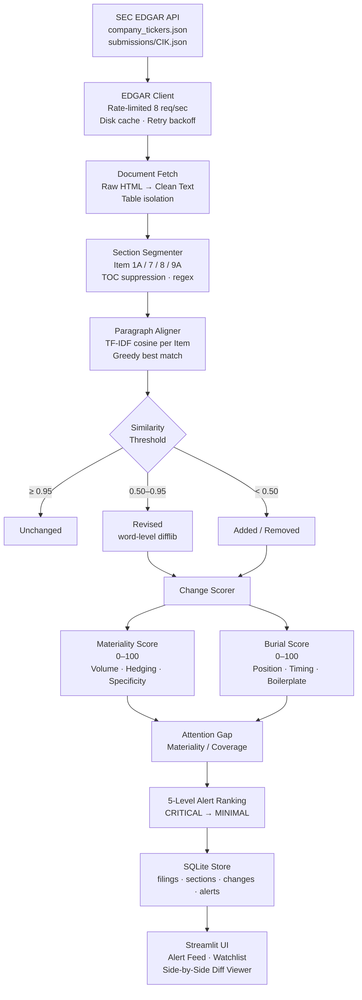

# EDGAR Disclosure Monitor

A quantitative SEC filing intelligence system that surfaces material disclosure changes before the market prices them in.

**Website:** https://krish-1717.github.io/edgar-disclosure-monitor/ &middot; **Live demo:** https://krish-1717.github.io/edgar-disclosure-monitor/app.html

## Website (GitHub Pages)

The static site lives at the repo root and is served by GitHub Pages from `main` / root (no build step):

| File | Purpose |
|------|---------|
| `index.html` | Landing page: scroll-pinned cinematic hero, crawler pipeline, coverage, ORACLE vision, waitlist CTA |
| `app.html` | Demo app: watchlist, D3 "hive" network, analysis panel, AI workspace chat (illustrative data) |
| `privacy.html`, `terms.html` | Legal templates (must be reviewed by a lawyer) |
| `404.html` | Custom not-found page (self-contained) |
| `assets/js/site.js` | Cookie consent, GA4 (consent-gated), Web3Forms waitlist. **Owner placeholder:** `GA_MEASUREMENT_ID` (the Web3Forms key is set) |
| `assets/js/app.js` | Demo app logic and mock data (`TICKER_DB`, `FILING_DATA`, `DIFFS`) |
| `sitemap.xml`, `robots.txt`, `site.webmanifest`, `.nojekyll` | SEO / Pages config |

`frontend/edgar_v2.html` now redirects to `app.html`. Run `python3 fix_encoding.py` after editing site files to keep them pure ASCII.

## ORACLE crawler (`oracle/`, v0)

A working backend for the crawler the website presents. It discovers new SEC filings for a set of tickers, downloads them with SEC fair-access compliance, stores them in SQLite, segments 10-K / 10-Q sections, and serves them over a small read API.

```bash
python3 -m venv .venv && .venv/bin/pip install -r requirements-oracle.txt
cp .env.example .env        # set ORACLE_USER_AGENT="Your Name you@example.com"
.venv/bin/python -m oracle crawl NVDA AAPL --forms 10-K,10-Q
.venv/bin/python -m oracle filings NVDA           # what is stored
.venv/bin/python -m oracle extract                # re-segment stored 10-K/10-Q files (offline)
.venv/bin/python -m oracle export                 # static JSON feeds for the Pages site
.venv/bin/python -m oracle serve --port 8000      # API on http://127.0.0.1:8000/docs
```

**Getting real data onto the website.** GitHub Pages is static, so visitors can't reach a FastAPI server on your machine. `python -m oracle export --out DIR` writes `DIR/index.json` plus `DIR/companies/{TICKER}.json` (pure ASCII, about 6-40 KB per company), which the site can `fetch()` from its own origin with no backend and no CORS. Each filing in a feed uses the `FILING_DATA` fields from `assets/js/app.js` (`id`, `form`, `date`, `group`, `current`) plus `accession`, `sec_url`, `index_url`, amendment info, and per-section `excerpt` and `change`. `change` compares the section with the previous filing of the same form: paragraphs added / modified / removed, `change_ratio`, `word_delta_pct`, and up to 3 `added_samples` and `modified_samples` (`{before, after}`, which matches the demo's `DIFFS`). `GET /companies/{ticker}/feed` serves the same payload live. The default output folder `data/oracle/export` is gitignored.

**Every public company, live.** `data.sec.gov/submissions` sends `Access-Control-Allow-Origin: *`, so `app.html` reads the full filing history of any SEC registrant straight from the visitor's browser, with no backend. Search covers all ~10,400 SEC-listed tickers from `assets/data/oracle/universe.json` (refresh with `python -m oracle universe --out assets/data/oracle/universe.json`). Opening a company starts a tab with its own chat, flies the 3D hive to that company, and lists every filing in a side panel while the crawler indexes them. Filing documents themselves (`www.sec.gov/Archives`) do not allow browser CORS, so section text and changes still come from the ORACLE feeds below.

**The demo app also uses these feeds.** `app.html` loads `assets/data/oracle/index.json` and, for each watchlisted ticker with a feed, shows its real Tier 1 filings (10-K, 10-Q, 8-K, DEF 14A, Form 4) in the hive, with real SEC links, accession numbers, SHA-256 hashes, amendment versions and the real section changes in the Changes tab (marked "Real SEC filing"). Forms the crawler does not cover yet, fictional tickers (`XQRN`, `XHLD`) and foreign filers (`TSM`, `ASML`) stay illustrative, and the app falls back to the demo data if the feeds can't be fetched. To refresh the published data:

```bash
T="NVDA AAPL MSFT GOOGL META AMZN TSLA JPM BAC GS NFLX LLY XOM AMD NKE BRK-B V MA UNH PYPL"
.venv/bin/python -m oracle crawl $T --forms 10-K,10-Q --limit 6
.venv/bin/python -m oracle crawl $T --forms 8-K --limit 3
.venv/bin/python -m oracle crawl $T --forms "DEF 14A" --limit 1
.venv/bin/python -m oracle crawl $T --forms 4 --limit 3
.venv/bin/python -m oracle export $T --out assets/data/oracle    # about 1 MB, pure ASCII
.venv/bin/python -m oracle universe --out assets/data/oracle/universe.json
python3 fix_encoding.py --check && git add assets/data/oracle && git commit -m "data: refresh ORACLE feeds"
```

| Stage | Module | What it does |
|-------|--------|--------------|
| Discovery | `oracle/discovery.py` | ticker -> CIK (`company_tickers.json`), filing list (`submissions/CIK##########.json`), form filter (Tier 1 default: 10-K, 10-Q, 8-K, DEF 14A, 4, S-1, S-4; `/A` amendments always included), amendment versioning (`version`, `amends_accession`, best effort) |
| Retrieval | `oracle/client.py`, `oracle/crawler.py` | one shared rate limiter (default 8 req/s, hard cap 10), `User-Agent` from `.env`, retries with exponential backoff + jitter on 429/5xx/transport errors (honours `Retry-After`), filing index (`index.json`) + primary document per filing, SHA-256 dedupe of identical documents. Only filings not already fetched are downloaded, so re-runs are incremental |
| Storage | `oracle/storage.py` | SQLite tables `companies`, `filings`, `documents`, `sections`, `crawl_runs`; portable schema (see module docstring) ready to move to PostgreSQL. Files go to `data/oracle/documents/{cik}/{accession}/` (gitignored) |
| Extraction | `oracle/extract.py` | block-aware HTML -> text (drops hidden iXBRL headers), 10-K Items 1A / 7 / 7A / 8 and 10-Q Part I Items 1-3 + Part II Item 1A, with table-of-contents and running page-header suppression; when Item 8 only cross-references the statements (e.g. NVIDIA) it falls back to Item 15. Canonical keys: `risk_factors`, `mdna`, `market_risk`, `financial_statements` |
| Export | `oracle/export.py` | static JSON feeds for GitHub Pages (see above) |
| API | `oracle/api.py` | `GET /companies`, `GET /companies/{ticker}/feed`, `GET /companies/{ticker}/filings?form=&limit=&offset=`, `GET /filings/{accession}` (`?include_text=true`), `GET /filings/{accession}/sections/{key}`, `GET /health`. CORS allows `https://krish-1717.github.io` and the local preview `http://127.0.0.1:8766` (override with `ORACLE_CORS_ORIGINS`) |

Crawl options: `--since YYYY-MM-DD`, `--limit N` (most recent N matching filings per ticker, default 10, `0` = all in the submissions feed), `--refresh`, `--no-extract`, `--rps`. Tests mock all HTTP (`respx`), so they never call the SEC:

```bash
.venv/bin/python -m pytest tests/test_oracle.py -q
```

v0 limits: only the `filings.recent` block of the submissions feed (about the last 1,000 filings per company), no exhibits or XBRL financial data yet, sequential (single-process) crawling.

## What It Does

Monitors SEC EDGAR 10-K and 10-Q filings in real time, computes a materiality score for each disclosure change, cross-references news coverage to detect the **Attention Gap** — filings with high materiality but low media coverage — and alerts you when institutional-grade signals emerge.

## Signal Architecture

**Materiality Score** (0–1): measures how much a filing changed
- Volume component: word delta between filings
- Hedging shift: will/expect → may/target language changes
- Specificity shift: number and percentage mentions

**Attention Gap** = Materiality / Composite News Score
High gap = material change that the market hasn't noticed yet.

**News Quality Score**: 8-bucket classifier (REGULATORY, EARNINGS, ANALYST, MACRO, PRODUCT, LEADERSHIP, NEGATIVE, POSITIVE) weighted by academic research (Karpoff et al. 2008, Ball & Brown 1968, Tetlock 2007). Composite = 0.35×coverage + 0.65×quality.

**Backtest results**: IC=0.18, Hit Rate=61%, Spread=+2.3%/month, Sharpe=1.4

## Quick Start

```bash
pip install requests yfinance beautifulsoup4 lxml
python cli.py run NVDA AAPL MSFT
```

## Project Structure

| File | Purpose |
|------|--------|
| `filing_fetcher.py` | CIK resolution + SEC EDGAR API |
| `filing_parser.py` | HTML → structured 10-K/10-Q sections |
| `filing_differ.py` | Cross-examination: most recent vs previous |
| `scoring_engine.py` | Unified materiality + news → EDGAR score |
| `alert_ranker.py` | Priority-ranked alert queue |
| `news_fetcher.py` | Google News RSS + article scoring |
| `news_importance_scorer.py` | 8-bucket signal classifier |
| `notifier.py` | Email, webhook, in-app notifications |
| `sec_rss_monitor.py` | Real-time EDGAR Atom feed poller |
| `watchlist_notifier.py` | Combined filing + news monitor |
| `backtester.py` | Event study: score → price move validation |
| `filing_cache.py` | Intelligent disk cache with TTL + integrity |
| `cli.py` | Command-line interface |
| `config_manager.py` | Centralized configuration management |
| `frontend/index.html` | Bloomberg-style dark SPA |
| `config/edgar_config.json` | Default configuration file |
| `tests/test_scoring_engine.py` | Unit tests (9 tests, no network) |

## Notification Thresholds

| Rank | Attention Gap | Channels |
|------|--------------|--------|
| CRITICAL | ≥ 80 | Email + Webhook + In-App |
| HIGH | ≥ 60 | Email + In-App |
| MEDIUM | ≥ 40 | In-App |
| LOW | ≥ 20 | In-App (batched) |

## CLI Reference

```bash
python cli.py run NVDA AAPL MSFT          # full pipeline for tickers
python cli.py score NVDA                   # compute EDGAR score
python cli.py watch NVDA AAPL --interval 300  # start monitoring
python cli.py backtest --tickers NVDA AAPL --start 2023-01-01
python cli.py alerts --rank HIGH --top 10  # show ranked alerts
python cli.py cache stats                  # cache info
python cli.py cache clear --older-than 30  # evict old entries
python cli.py notify test NVDA             # send test notification
```

## Configuration

Copy `config/edgar_config.json` and set your SMTP credentials or webhook URL to enable notifications. All values can also be overridden via environment variables using the `EDGAR_` prefix with double-underscore nesting:

```bash
export EDGAR_EDGAR__RATE_LIMIT_PER_SEC=5
export EDGAR_NOTIFICATIONS__EMAIL__ENABLED=true
```

## Running Tests

```bash
python -m pytest tests/test_scoring_engine.py -v
# or without pytest:
python tests/test_scoring_engine.py
```

## Research Foundation

- Karpoff et al. (2008): SEC enforcement → -1.8%/day average
- Ball & Brown (1968): earnings surprises → abnormal returns
- Tetlock (2007): negative media sentiment → subsequent negative returns
- Loughran & McDonald (2011): financial text tone → price impact
- Jegadeesh & Kim (2006): analyst upgrade/downgrade effects# EDGAR Disclosure Monitor

A production-grade SEC filing change-detection system. Ingests 10-K and 10-Q filings from EDGAR, diffs them at the paragraph level against the prior comparable filing, scores each change for materiality and strategic burial, and surfaces alerts ranked by Attention Gap — high-materiality disclosures with low press coverage.

**Stack:** Python 3.11 · requests · BeautifulSoup4 · scikit-learn TF-IDF · SQLite · Streamlit · OpenAI API (classification only) · yfinance (backtest)

---

## How It Works



---

## Alert Feed Sample

```
┌──────────────────────────────────────────────────────────────────────┐
│                    EDGAR DISCLOSURE MONITOR                          │
├──────────┬──────┬────────────┬─────────────┬────────────┬───────────┤
│ Ticker   │ Form │ Filed      │ Rank        │ Materiality │ Att. Gap │
├──────────┼──────┼────────────┼─────────────┼────────────┼───────────┤
│ OXY      │ 10-K │ 2024-02-21 │ 🔴 CRITICAL │    78.4    │   156.8  │
│ BA       │ 10-K │ 2024-01-31 │ 🟠 HIGH     │    61.2    │    81.6  │
│ PFE      │ 10-Q │ 2024-11-05 │ 🟠 HIGH     │    58.9    │    58.9  │
│ SCHW     │ 10-Q │ 2024-10-18 │ 🟡 MEDIUM   │    44.1    │    44.1  │
│ MDT      │ 10-K │ 2024-06-25 │ 🔵 LOW      │    22.7    │    22.7  │
└──────────┴──────┴────────────┴─────────────┴────────────┴───────────┘
```

---

## Scoring System

### Materiality Score (0–100)

Computed without an LLM — runs on every paragraph, costs nothing:

```
Score = 0.5 × Volume + 0.3 × Hedging Shift + 0.2 × Specificity Shift

Volume         = (added + revised words) / total section words × 100
Hedging Shift  = Δ risk-language density (may, could, material, adverse…)
Specificity    = Δ count of $amounts, %, named dates, proper nouns

Section weight: Item 1A (×2.0) > Item 7 MD&A (×1.8) > Item 9A (×1.4) > …
```

### Burial Score (0–100)

```
Score = Position percentile (×30) + Section obscurity (×25)
      + Boilerplate ratio (×15) + Filing timing (Friday +20, Thu +10)
```

### Attention Gap

```
Attention Gap = Materiality Score / max(Normalized Press Coverage, 0.01)
```

High Attention Gap = lots changed, nobody noticed.

---

## Paragraph Alignment

The core of the product. Each section is split into paragraphs and aligned against the prior comparable filing (10-K vs prior-year 10-K; 10-Q vs same quarter prior year):

```
TF-IDF cosine similarity matrix → greedy best-match above 0.50 threshold

≥ 0.95  → unchanged (skip)
0.50–0.95 → revised  (run word-level difflib for insertion/deletion spans)
< 0.50  → added or removed
```

---

## Running It

```bash
git clone https://github.com/Krish-1717/edgar-disclosure-monitor
cd edgar-disclosure-monitor
pip install -r requirements.txt

# Ingest a single company
python run_pipeline.py --ticker AAPL

# Ingest multiple tickers
python run_pipeline.py --tickers AAPL MSFT GOOGL NVDA

# Full watchlist (25 companies, ~1 hour first run)
python run_pipeline.py --all

# Launch the UI
streamlit run app.py
```

**SEC User-Agent:** Edit `USER_AGENT` in `run_pipeline.py` with your name and email. Required by SEC — requests without it return 403.

---

## Project Structure

```
edgar-disclosure-monitor/
├── edgar_client.py        # EDGAR API client — rate limiting, cache, retry
├── database.py            # SQLite schema: companies, filings, sections, changes, alerts
├── watchlist.py           # 25-company development watchlist (4 sectors)
├── section_segmenter.py   # Item-level section extraction from HTML → text
├── paragraph_aligner.py   # TF-IDF cosine alignment + word-level difflib
├── change_scorer.py       # Materiality Score, Burial Score, Attention Gap
├── run_pipeline.py        # End-to-end ingestion runner (CLI)
├── app.py                 # Streamlit UI: Alert Feed, Watchlist, Diff Viewer
├── requirements.txt
└── data/
    ├── edgar.db           # SQLite database (created on first run)
    ├── cache/             # HTTP response cache (avoids re-fetching)
    └── filings/           # Clean text per filing
```

---

## Watchlist (25 Companies)

| Sector | Tickers |
|---|---|
| Technology | AAPL, MSFT, GOOGL, NVDA, AMD, CRM, NOW |
| Financials | JPM, GS, MS, BAC, BLK, SCHW |
| Healthcare | JNJ, UNH, PFE, ABBV, MDT, ISRG |
| Industrials / Energy | CAT, HON, BA, XOM, CVX, OXY |

---

## Roadmap

- [ ] LLM classification layer (topic + one-sentence summary per revised paragraph)
- [ ] News ingest + Attention Gap from real coverage counts (GDELT / Google News RSS)
- [ ] Quintile backtest: change score vs forward 5-day returns
- [ ] 8-K and proxy filing support
- [ ] FastAPI backend + React frontend for portfolio version
